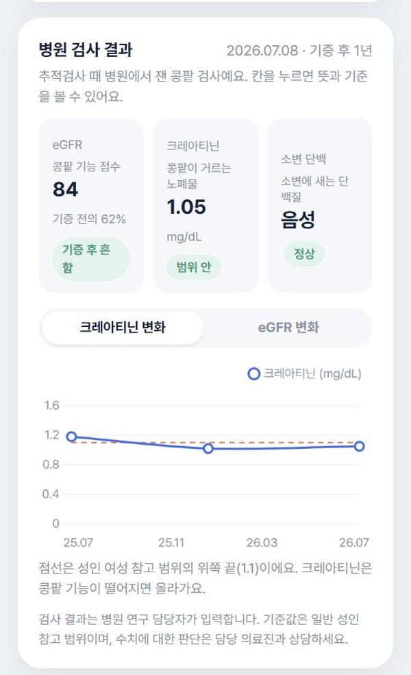
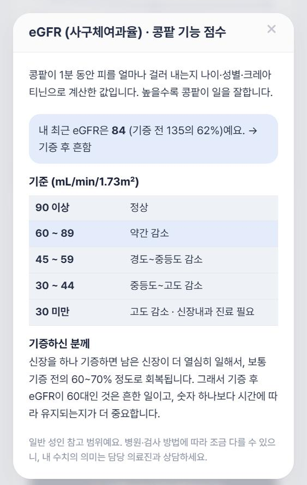
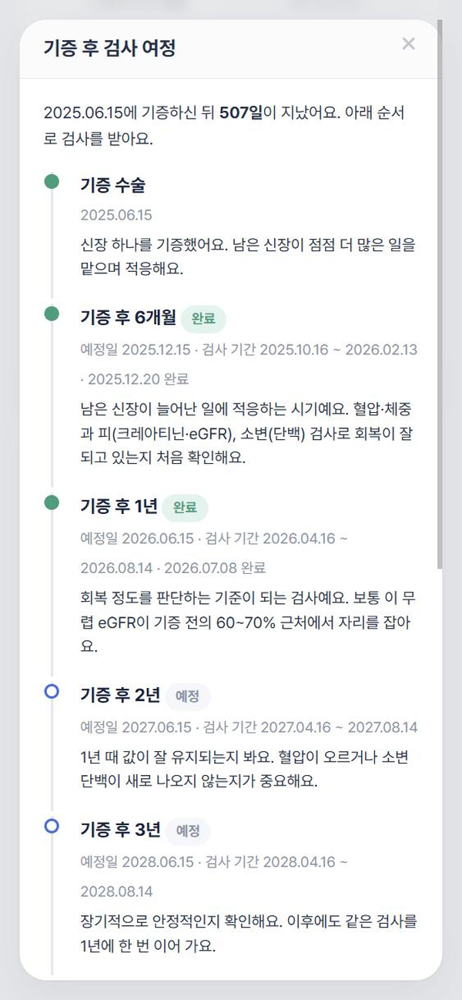
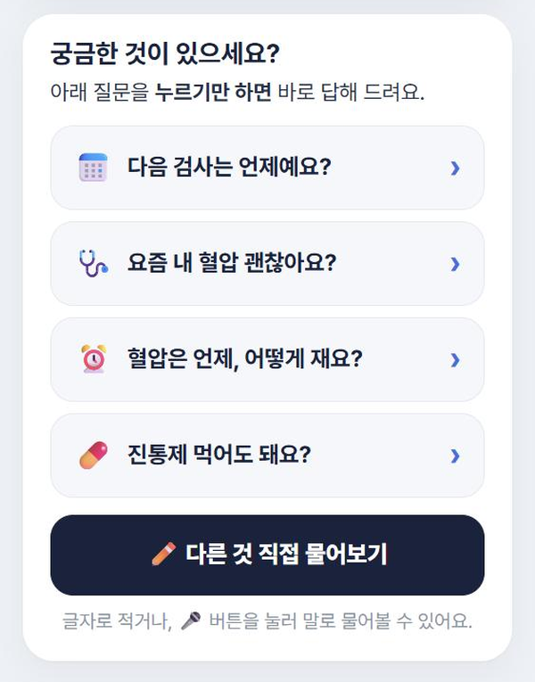
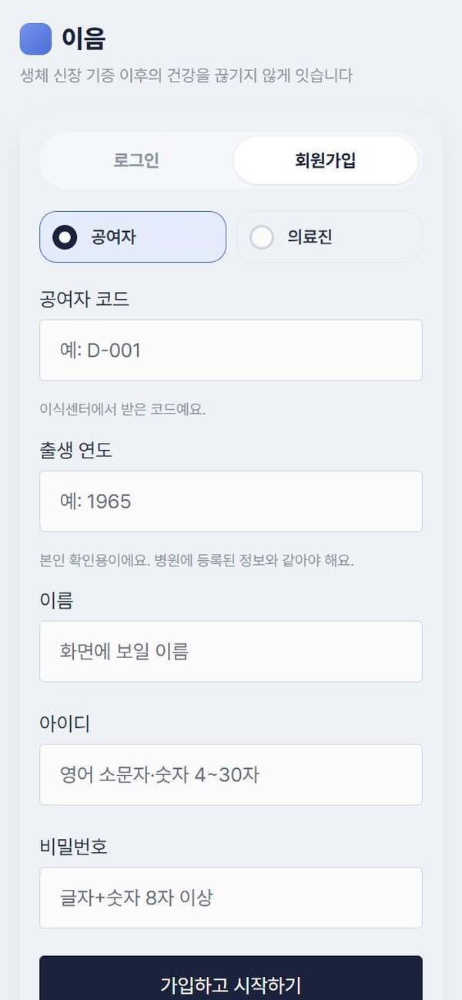
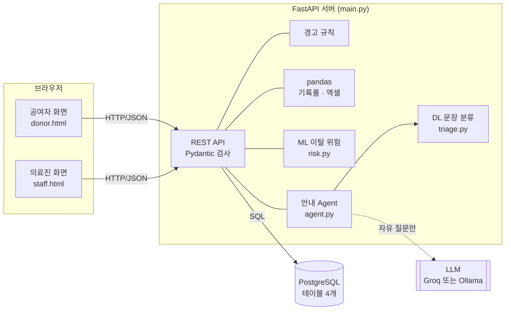
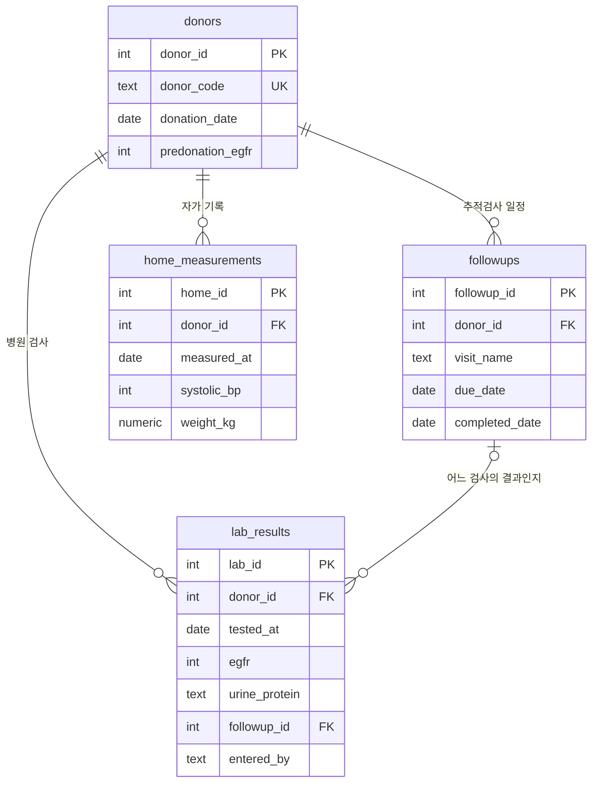

# 이음 · 생체 신장 공여자 장기 추적관리

신장을 기증한 **생체 공여자**가 기증 후 정기 추적검사를 놓치지 않도록 돕는 웹 애플리케이션입니다.
공여자는 집에서 혈압·체중을 기록하고 안내 Agent에게 질문하며, 의료진(연구 코디네이터)은 검사 결과를 입력하고 **검사를 놓쳤거나 위험 신호가 있는 공여자**를 한눈에 확인합니다.

> 임상연구 코디네이터(CRC)로 일하며 대상자 일정·연구 데이터를 관리했던 경험에서 출발했습니다.
> 생체 공여자는 기증 후 시간이 지날수록 추적검사에서 이탈하기 쉬운데, 그 이탈을 **기록 · 경고 · 예측 · 안내**로 줄이는 것이 목표입니다.

> ⚠️ 이 프로젝트의 데이터는 모두 **데모·합성 데이터**이며, 경고 기준값·안내문·모델은 **임상 검증 전 시연용**입니다.

## 바로 체험하기

**👉 [ieum-donor-care.vercel.app](https://ieum-donor-care.vercel.app)** — 첫 화면의 **[공여자 화면] [의료진 화면]** 버튼을 누르면 로그인 없이 들어갑니다.
가상 데이터이며 매일 새벽 3시(한국 시간)에 처음 상태로 돌아갑니다. 공여자 화면 위의 "처음이라면 이 순서로 둘러보세요" 4단계를 따라가면 5분 안에 주요 기능을 볼 수 있습니다.

| 공여자 | 의료진 |
|---|---|
| 혈압·체중 기록 (🎤 말로 · 📷 혈압계 사진으로도 입력) | 추적검사 놓침 · 자가 기록 끊김 · 이탈 위험 한눈에 |
| 저장 직후 판정 + 높음·낮음 알림 소리 + 대처 4단계 + 119 안내 | 모의 EMR(FHIR R4)에서 검사 결과 자동 가져오기 |
| 검사 결과를 쉬운 말과 기준표로 설명 | 연구 데이터 엑셀 · REDCap 형식 eCRF CSV 내보내기 |
| 안내 Agent (내 기록 조회 · 응급 문장은 119 안내) | 상담 요청 · 전화 예약 확인과 처리 |
| 상담사 연결: 지금 바로 전화 · 30분 단위 전화 예약 | 공여자 상세: 기증한 쪽 기록 · 수치별 "왜 중요해요?" 설명 |

## 화면

**공여자 화면** · 어르신도 알기 쉽게: 무슨 기록인지 한 줄 설명, 내 수치가 기준의 어디쯤인지, 누르기만 하면 답하는 질문 버튼

<table>
  <tr>
    <td align="center" width="33%"><b>첫 화면</b><br><sub>오늘 기록 · 다음 검사 D-day</sub></td>
    <td align="center" width="33%"><b>병원 검사 결과</b><br><sub>쉬운 이름 · 판정 · 크레아티닌 그래프</sub></td>
    <td align="center" width="33%"><b>수치 설명</b><br><sub>기준표에서 내 위치 · 기증자용 설명</sub></td>
  </tr>
  <tr>
    <td valign="top"></td>
    <td valign="top"></td>
    <td valign="top"></td>
  </tr>
  <tr>
    <td align="center"><b>검사 여정</b><br><sub>6개월 · 1년 · 2년 · 3년 · 매년</sub></td>
    <td align="center"><b>물어보기</b><br><sub>큰 질문 버튼 · 말로 묻기(🎤)</sub></td>
    <td align="center"><b>안내 Agent</b><br><sub>내 기록에서 바로 답</sub></td>
  </tr>
  <tr>
    <td valign="top"></td>
    <td valign="top"></td>
    <td valign="top"></td>
  </tr>
  <tr>
    <td align="center"><b>로그인 · 회원가입</b><br><sub>공여자 코드 + 출생 연도로 본인 확인</sub></td>
    <td align="center" colspan="2"><b>안전 안내</b><br><sub>응급 증상은 AI 답변 대신 119 안내</sub></td>
  </tr>
  <tr>
    <td valign="top"></td>
    <td valign="top" colspan="2"></td>
  </tr>
</table>

**의료진 화면** · 놓친 추적검사, 혈압 경고, 이탈 위험 예측, 최근 12주 자가 기록률을 한눈에 보고, EMR(FHIR)에서 검사 결과를 가져오며, 연구 데이터를 엑셀 · eCRF 형식으로 내려받습니다.


---

## 주요 기능

| 대상 | 기능 | 사용 기술 |
|---|---|---|
| 공여자 | **하루 1회** 혈압·체중 기록(측정 방법 안내, 저장 즉시 높음·낮음 판정), 최근 12주 그래프, 다음 추적검사 D-day, 알림함 | FastAPI · PostgreSQL · Chart.js |
| 공여자 | 검사 수치 쉬운 설명: eGFR · 크레아티닌 · 소변 단백 기준표에서 **내 수치 위치** 표시, 크레아티닌·eGFR 변화 그래프, 기증 후 **검사 여정** 설명 | 기준값 API (`/guide/reference`) |
| 공여자 | **휴대폰 앱**: 큰 글씨, 매일 소리 알림, 블루투스 혈압계·체중계(표준 BLE) | React Native (Expo) |
| 공통 | **로그인·회원가입**: 공여자는 본인 기록만, 의료진은 가입 코드 필요. 비밀번호 PBKDF2 해시, 세션 토큰 해시 저장, 로그인 시도 제한 | auth.py |
| 공여자 | **안내 Agent**: 내 기록·일정 질문, 기증 후 생활 안내, 응급 증상 시 119 안내 | LLM(Groq / Ollama) · 딥러닝 문장 분류 |
| 의료진 | 검사 결과 입력 → 해당 추적검사 **자동 완료 처리** | SQL 트랜잭션 · UPSERT |
| 의료진 | 공여자 목록: 놓친 검사 · 검사 기간 · 경고 · 12주 기록률 · **이탈 위험 예측** | 규칙 엔진 · 머신러닝 |
| 의료진 | **EMR 연동**: FHIR Observation(LOINC)으로 검사 결과 자동 가져오기, 단위 변환·중복 건너뜀·추적검사 자동 완료 (모의 EMR) | FHIR R4 · LOINC |
| 의료진 | **연구 데이터 엑셀** (시트 7개) + **eCRF 입력용 CSV · 변수 정의서** (REDCap 가져오기 형식, 숫자 코드) | pandas · openpyxl |

## 구조



## 데이터베이스



- 공여자가 입력하는 값(혈압·체중)과 병원 검사값(eGFR·크레아티닌·단백뇨)은 **입력 주체와 주기가 달라** 테이블을 분리했습니다.
- `UNIQUE(공여자, 날짜)` + `ON CONFLICT DO UPDATE`로 하루 1건을 데이터베이스 수준에서 보장합니다.
- 추적검사 상태(완료 · 검사 기간 · 놓침 · 예정)는 **저장하지 않고 날짜로 계산**합니다. 예정일 ±60일을 검사 기간으로 봅니다.

## 안내 Agent 설계

질문은 위에서부터 차례로 검사해, **AI가 꼭 필요한 질문만** LLM으로 보냅니다.

| 순서 | 판단 | 답하는 방식 | 응답 시간 |
|---|---|---|---|
| ① | 응급 (단어 목록 **또는** DL 분류) | 119·응급실 안내 | 즉시 |
| ② | 일반 대화 (DL 분류) | 정해진 답 + 오늘 기록 권유 | 즉시 |
| ③ | 안내문 주제 (진통제·운동·eGFR…) | 이식센터 안내문 그대로 | 즉시 |
| ④ | 내 기록 (검사 일정·혈압·검사 결과) | 실제 값으로 답 | 즉시 |
| ⑤ | 그 밖의 자유 질문 | LLM (스트리밍) | Groq 약 2~4초 |

**안전 설계**
- LLM에는 서버가 조회한 **이 공여자의 자료만** 넣어 줍니다. 공여자 코드는 서버가 고정하므로 다른 공여자의 기록은 볼 수 없습니다.
- 답을 내보내기 전에 **"정상 범위" 같은 판단 표현을 검사**해 걸리면 의료진 확인 안내로 바꿉니다.
- 진단·처방·수치 판단은 하지 않도록 지시하고, 검사 결과 해석은 의료진이 전달하도록 했습니다.

**실제로 겪은 문제와 해결**
- 로컬 3B 모델이 도구를 부르지 않고 혈압을 "120/80, 정상 범위"라고 **지어냄** → 도구 호출 대신 서버가 자료를 넣어 주는 방식 + 출력 검사로 해결
- 로컬 모델 응답이 느림 → 측정해 보니 첫 글자까지 59초 중 대부분이 **프롬프트 읽기 시간** → 프롬프트 축소 · 공여자 자료 미리 읽혀 두기 · 스트리밍으로 **첫 응답 59초 → 3.5초**
- 클라우드(Groq)를 선택지로 추가: 자유 질문 **18~22초 → 2~4초**. 실제 의료 환경에서는 `.env` 한 줄로 **기록이 밖으로 나가지 않는 로컬 모델**로 바꿀 수 있게 했습니다.

## 머신러닝 · 딥러닝

### 추적검사 이탈 위험 (ML)
- 입력값 7개: 12주 기록률, 기록이 끊긴 주 수, 이전에 놓친 검사 수, 평균 지연일, 기증 후 햇수, 나이, 혈압 경고
- 로지스틱 회귀 vs 랜덤 포레스트, 5겹 교차검증 AUC **0.812 vs 0.801** → 설명하기 쉬운 로지스틱 회귀 선택
- 서버는 계수를 JSON으로 읽어 계산하고, 확률을 가장 많이 올린 **이유 2개**를 함께 보여 줍니다.

### 공여자 문장 분류: 응급 / 문의 / 일반 (DL, PyTorch)
- 한국어 띄어쓰기·말끝 차이에 강하도록 **글자 1~3개 조각**을 사용 (EmbeddingBag → Linear+ReLU → Linear)
- 같은 문장 틀이 학습·평가에 섞이지 않게 **GroupKFold**로 평가: 정확도 0.798 (로지스틱 회귀 0.831), 응급 재현율 0.72~0.77
- 성능이 단순 모델과 비슷해, 안전장치는 **단어 목록과 모델을 함께** 쓰는 구조로 설계했습니다.

> 두 모델 모두 **합성 데이터**로 학습했습니다. 수치는 파이프라인 동작 확인용이며, 실제 적용에는 실제 데이터·IRB 승인·가명처리가 필요합니다.

## 기술 스택

| 영역 | 사용 |
|---|---|
| 백엔드 | Python 3.14, FastAPI, Pydantic v2, psycopg 3 |
| 데이터베이스 | PostgreSQL |
| 데이터 | pandas, openpyxl |
| ML · DL | scikit-learn, PyTorch (서버에서는 numpy로 추론) |
| LLM | Groq (gpt-oss-120b), Ollama (qwen2.5:3b) — 선택 |
| 프론트엔드 | HTML · CSS · JavaScript, Pico CSS, Chart.js |
| 앱 | React Native (Expo), expo-notifications, expo-secure-store, react-native-ble-plx |
| 표준 | FHIR R4 · LOINC (EMR), REDCap 가져오기 형식 (eCRF), BLE GATT 혈압 0x1810 · 체중 0x181D |

## 실행 방법

```bash
# 1. 가상환경과 패키지
python -m venv .venv
.venv\Scripts\Activate.ps1          # macOS/Linux: source .venv/bin/activate
pip install -r requirements.txt

# 2. 데이터베이스 (PostgreSQL에 donor_care 데이터베이스를 만든 뒤)
psql -d donor_care -f schema.sql
psql -d donor_care -f seed_demo.sql   # 데모 공여자 D-001 ~ D-003

# 3. 설정: .env.example 을 .env 로 복사하고 DB 비밀번호 등을 채운다
#    STAFF_INVITE_CODE: 의료진 가입 코드 (비우면 의료진 가입 불가)
#    LLM 없이도 동작합니다(규칙 답변). 자유 질문 AI를 쓰려면 GROQ_API_KEY 또는 Ollama 설정
#    로그인용 테이블(users, sessions)은 서버가 시작할 때 자동으로 만듭니다 (migrate_auth.sql 과 같음)

# 4. 서버 실행
uvicorn main:app --reload
```

| 주소 | 화면 |
|---|---|
| http://127.0.0.1:8000/login | 로그인 · 회원가입 (공여자: 공여자 코드 + 출생 연도) |
| http://127.0.0.1:8000/ | 공여자 화면 (공여자는 본인 기록, 의료진은 공여자 선택) |
| http://127.0.0.1:8000/staff | 의료진 목록 |
| http://127.0.0.1:8000/dashboard?code=D-001 | 공여자 상세 |
| http://127.0.0.1:8000/docs | API 문서 (자동 생성) |
| http://127.0.0.1:8000/health | 서버 · LLM 연결 상태 |

**모델 다시 학습 (선택)**
```bash
pip install scikit-learn torch
python ml/make_synthetic.py && python ml/train.py          # 이탈 위험
python ml/triage_data.py && python ml/train_triage.py      # 문장 분류
```

## 폴더 구조

```
main.py            FastAPI 서버: API, 경고 규칙, pandas 집계, 엑셀 내보내기
auth.py            로그인 · 회원가입 · 세션 (PBKDF2, 세션 토큰 해시)
emr.py             EMR 연동: FHIR Observation 받기 · 해석 (모의 EMR 포함)
ecrf.py            eCRF(REDCap) 입력용 표 · 변수 정의서
consult.py         상담 전화 예약 시간표 (평일 30분 단위, 자정에 날짜 넘김)
vision.py          혈압계 사진에서 숫자 읽기 (AI 이미지 모델, 사람이 확인 후 저장)
clock.py           한국 시간 기준 오늘 (서버·DB가 UTC라 날짜 어긋남 방지)
mobile_src/        휴대폰 앱 소스 (React Native · Expo) — mobile_src/README.md
agent.py           안내 Agent: 질문 분류, 자료 주입, LLM 호출(스트리밍), 출력 검사
risk.py            이탈 위험 예측 (ML 계수로 계산)
triage.py          문장 분류 (DL 가중치로 numpy 추론)
ml/                합성 데이터 생성 · 학습 스크립트 · 학습된 모델
static/            donor.html · staff.html · dashboard.html · login.html
schema.sql         테이블 설계
seed_demo.sql      데모 데이터
docs/              기술 스택 · 데이터베이스 학습서 (PDF)
```

## API

| 메서드 | 주소 | 설명 |
|---|---|---|
| GET | `/donors/{code}/summary` | 기증 후 일수, 추적검사 일정·상태, 최근 eGFR |
| POST | `/home-measurements` | 혈압·체중 저장 (같은 날은 덮어쓰기) |
| POST | `/labs` | 검사 결과 저장 + 추적검사 자동 완료 |
| GET | `/donors/{code}/notifications` | 공여자 알림 계산 |
| GET | `/donors/{code}/alerts` | 의료진용 경고 (혈압 · eGFR · 단백뇨 · 체중) |
| POST | `/donors/{code}/chat/stream` | 안내 Agent (NDJSON 스트리밍) |
| GET | `/staff/overview` | 공여자별 상태 · 경고 · 기록률 · 이탈 위험 |
| GET | `/export/research.xlsx` | 연구 데이터 엑셀 (시트 7개) |
| GET | `/export/ecrf.csv?kind=data` · `kind=dictionary` | eCRF 입력용 CSV · 변수 정의서 |
| POST | `/emr/sync` | EMR(FHIR)에서 검사 결과 가져오기 |
| GET | `/mock-emr/fhir/Observation` | 모의 EMR FHIR 검색 (가상 자료) |
| POST | `/auth/signup` · `/auth/login` · `/auth/logout` | 회원가입 · 로그인 · 로그아웃 |
| GET | `/guide/reference` | 검사 수치·혈압 기준값과 쉬운 설명 |

## 한계와 다음 단계

- **로그인**: 역할별 접근 제한은 있으나, 누가 어떤 기록을 봤는지 남기는 감사 로그와 HTTPS 배포가 더 필요합니다.
- **EMR**: 모의 EMR(가상 자료)입니다. 실제 연결에는 병원 승인, SMART on FHIR 인증, 보안 심사가 필요합니다.
- **법·윤리**: 건강정보 별도 동의, 연구 활용 시 IRB 승인과 가명처리, 외부 LLM 사용 시 국외이전 동의 검토가 필요합니다.
- **경고 기준값·안내문**: 이식센터 의료진의 검토와 승인이 필요합니다.
- **모델**: 실제 추적 데이터로 다시 학습하고 외부 검증이 필요합니다.
- **개인정보**: 외부 LLM 사용 시 정보보호 검토가 필요하며, 기본값은 로컬 모델입니다.
- **알림**: 앱은 매일 소리 알림(기기 안 예약). 미기록 공여자에게 카카오 알림톡·문자를 보내는 기능은 사업자 채널 등록 후 연결 예정입니다.

---

만든 사람 · [@hyejin-log](https://github.com/hyejin-log)
